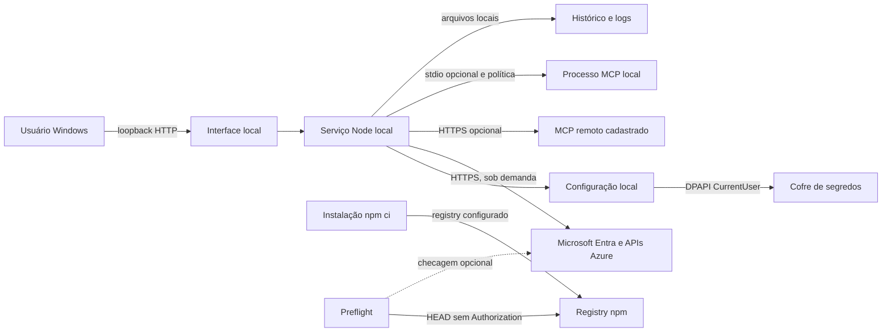

# Avaliação técnica de segurança corporativa — Tesseract 2.1 RC

## Estado e escopo

Este documento descreve o candidato local `2.1.0-rc.1` para análise. Não constitui autorização, certificação nem aprovação da organização. A PR #16 permanece draft e seu gate Linux de dependências é bloqueante. Nenhum teste desta missão consulta tenant corporativo ou executa Azure Cost Management.

## Arquitetura e limites de confiança



O navegador e o serviço são locais; o serviço escuta em `127.0.0.1`, padrão porta 4317. A instalação pode acessar o registry npm configurado para baixar dependências travadas. O preflight, por padrão, verifica conectividade de endpoints públicos Azure e do registry MCP com `HEAD` sem credenciais; pode omitir apenas os endpoints Azure na avaliação controlada. O runtime só chama provedores ou MCPs quando a funcionalidade é usada/configurada. Não se assume que a lista de destinos configuráveis representa conexões efetivamente ativas.

## Autenticação e dados

- A interface usa sessão local e controles de origem/CSRF nas rotas de gestão; tokens Microsoft usados por conectores permanecem no serviço.
- Segredos de configuração são protegidos por DPAPI no contexto do usuário Windows. Isso limita cópia entre contas/estações; a avaliação desta branch não migra credenciais.
- Configuração, conexões e orquestrações ficam em `%LOCALAPPDATA%\AzureCostLocal`; logs de serviço ficam sob `instances`. A sessão da aplicação é mantida em memória. JSON operacional pode conter metadados e payloads de negócio; o relatório de preflight não lê esses conteúdos.
- MCP pode executar processos stdio explicitamente configurados ou enviar solicitações a endpoints remotos. Políticas do produto limitam operações, mas classificação read-only não garante semântica sem efeitos externos. Avaliar cada servidor, ferramenta, schema e dado antes de uso.
- O produto mantém fluxos FinOps existentes. Dados e permissões dependem do provedor e perfil. Não há acesso demonstrado ao tenant pela validação M17.

## Rede e proxy/TLS

- **Instalação necessária:** HTTPS para o registry npm configurado (público ou corporativo), caso dependências ainda não estejam no cache.
- **Azure, sob demanda:** `login.microsoftonline.com` e `management.azure.com` para autenticação/Cost Management; outras APIs só pelos conectores escolhidos.
- **Opcionais:** MCP Registry para descoberta; hosts HTTP(S) ou executáveis stdio informados pelo usuário. Azure ARM MCP remoto e outros serviços só se explicitamente cadastrados.
- **Entrada local:** HTTP de loopback para UI/API. Não configurar bind de rede como parte desta distribuição.
- Clientes baseados no `fetch`/HTTP global do Node usam o proxy de ambiente da versão mínima; o wrapper ativa esse suporte somente quando `NODE_USE_ENV_PROXY` não foi definido, preservando o valor explícito `0`. A API Cost Management usa o cliente global configurado no código. Esse suporte está em estágio de estabilidade inicial e depende de validação corporativa.
- Os conectores que usam `fetchBound` (MCP HTTP configurado, modelos/agentes, Hub e outros endpoints customizados) usam um `undici.Agent` próprio que valida e fixa endereços DNS para reduzir SSRF. Esse dispatcher não consome `HTTP_PROXY`/`HTTPS_PROXY`; forçar o tráfego por proxy exigiria rever o pinning/ameaça de DNS rebinding. Proxy-only para esses conectores é limitação conhecida e requer desenho/teste separado. Não afirmar compatibilidade corporativa completa.
- Variáveis/proxy, `NO_PROXY` e certificados devem ser definidos pela infraestrutura. Nenhum proxy é inventado, e nenhum certificado é instalado.
- `NODE_EXTRA_CA_CERTS`, `NODE_USE_SYSTEM_CA`, `SSL_CERT_FILE`/`SSL_CERT_DIR` e configurações npm existentes são preservados. `NODE_TLS_REJECT_UNAUTHORIZED=0` e `npm strict-ssl=false` são bloqueados pelo diagnóstico.

## Dependências, componentes nativos e SBOM

`package.json` e `package-lock.json` definem dependências JS diretas/transitivas. O projeto inclui componentes nativos necessários, como `koffi`, e ferramentas de build/teste. `npm ci` executa apenas o procedimento declarado pelo npm e respeita a configuração/política de scripts da estação; o instalador verifica o carregamento nativo, sem aprovar scripts automaticamente. As licenças devem ser avaliadas a partir do SBOM e dos metadados dos pacotes para a distribuição corporativa.

Gerar SBOM local CycloneDX sem versionar o arquivo automaticamente:

```powershell
$sbom = Join-Path $env:TEMP 'tesseract-2.1-rc1.cdx.json'
npm sbom --sbom-format=cyclonedx | Set-Content -LiteralPath $sbom -Encoding utf8
```

O advisory [GHSA-fc5q-39xc-vjpf](https://github.com/advisories/GHSA-fc5q-39xc-vjpf), anteriormente associado à dependência transitiva `vitest` → `vite` → `tinyglobby` → `fdir` → `picomatch` 4.0.7, foi retirado pelo GitHub em 18/11/2026. A página indica que a retirada se baseia em informação do projeto upstream picomatch. Nas verificações locais de 18/11/2026, `npm audit --audit-level=high` e `npm audit --omit=dev --audit-level=high` terminaram com exit 0 e zero vulnerabilidades. Nenhuma dependência foi removida, substituída ou excepcionada por causa do alerta. Essa evidência local não substitui a execução da CI remota sobre o commit publicado; confirmar novamente antes de qualquer merge ou release.

## Operação, logs e riscos

- Start/status/stop identificam o processo do checkout e preservam processos alheios. Logs rotacionam localmente, mas podem conter dados técnicos; revisar antes de compartilhar.
- Atualização requer `main` limpa, fast-forward e build validado em worktree temporária; não transfere DPAPI nem migra dados operacionais. Restauração deve seguir backup controlado da organização.
- Não instala MCPs, não chama Azure durante startup e não requer MCP para iniciar.
- Riscos residuais: permissões locais/ACL dependem da estação; dados persistidos podem ser sensíveis; MCPs executam código ou transmitem dados conforme configuração; proxy integrado Node em estabilidade inicial; teste real de proxy, EDR, políticas corporativas e TLS ainda requer máquina gerenciada; retenção/backup dependem das políticas de operação do produto.

## Evidência e aprovação

Consultar `docs/relatorios/missao-17.md` para comandos e resultados observados. A avaliação deve incluir equipe de segurança, privacidade, infraestrutura, dependências/licenças, política de execução nativa, proxy e tratamento de dados. Nenhum dos itens acima representa aprovação formal.


## Referências técnicas

- [Node.js v24.20 CLI — proxy e CA do sistema](https://nodejs.org/download/release/v24.20.0/docs/api/cli.html).
- [Node.js — configuração de rede corporativa](https://nodejs.org/learn/http/enterprise-network-configuration).
- [GitHub Advisory GHSA-fc5q-39xc-vjpf](https://github.com/advisories/GHSA-fc5q-39xc-vjpf).
